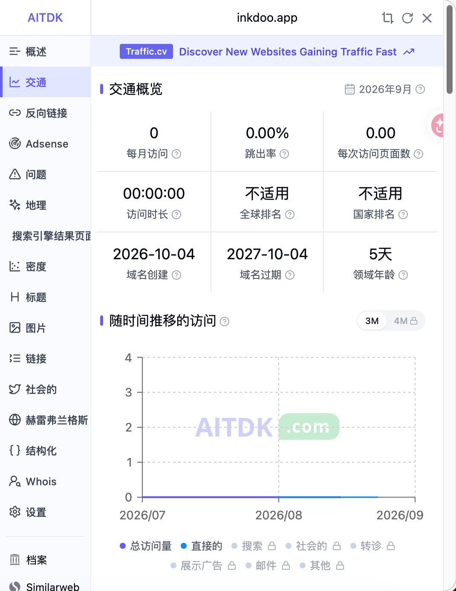
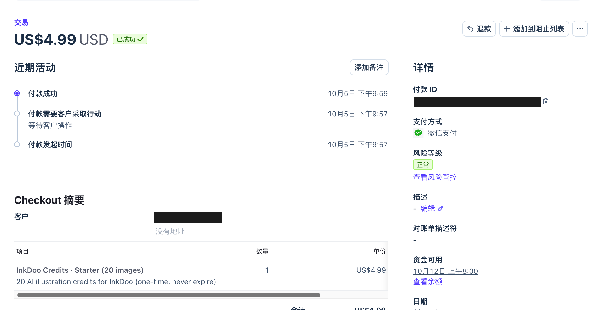
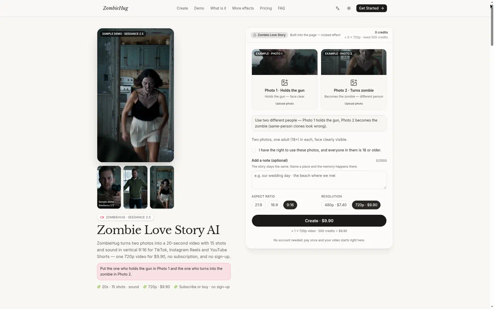
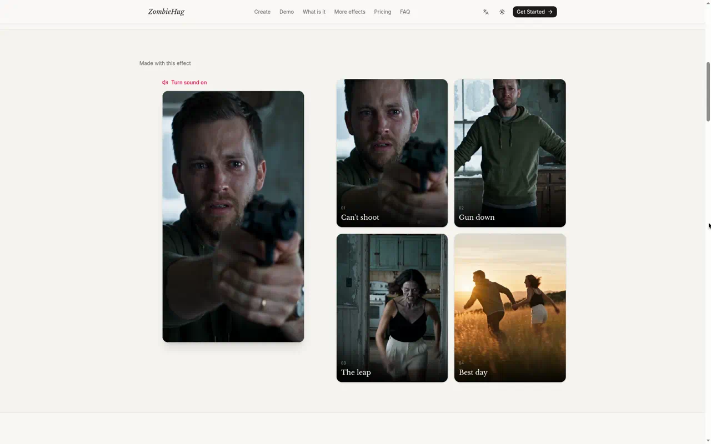
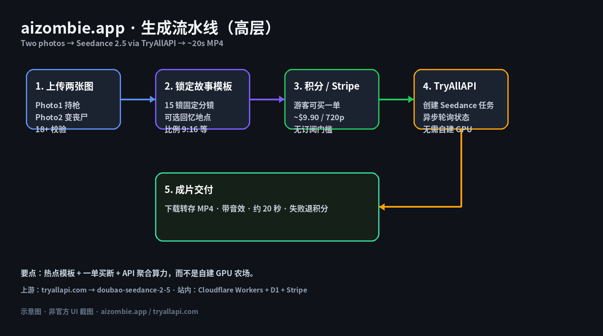
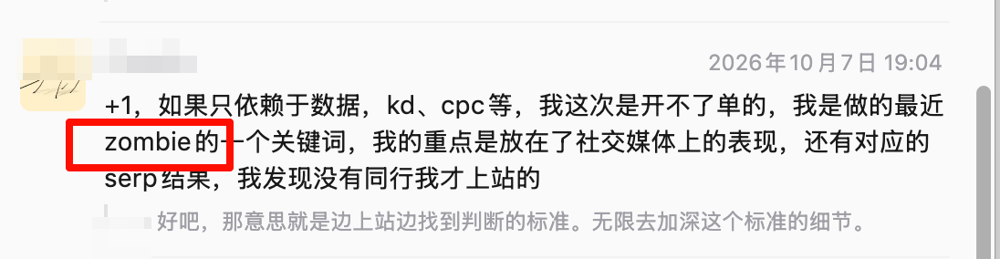
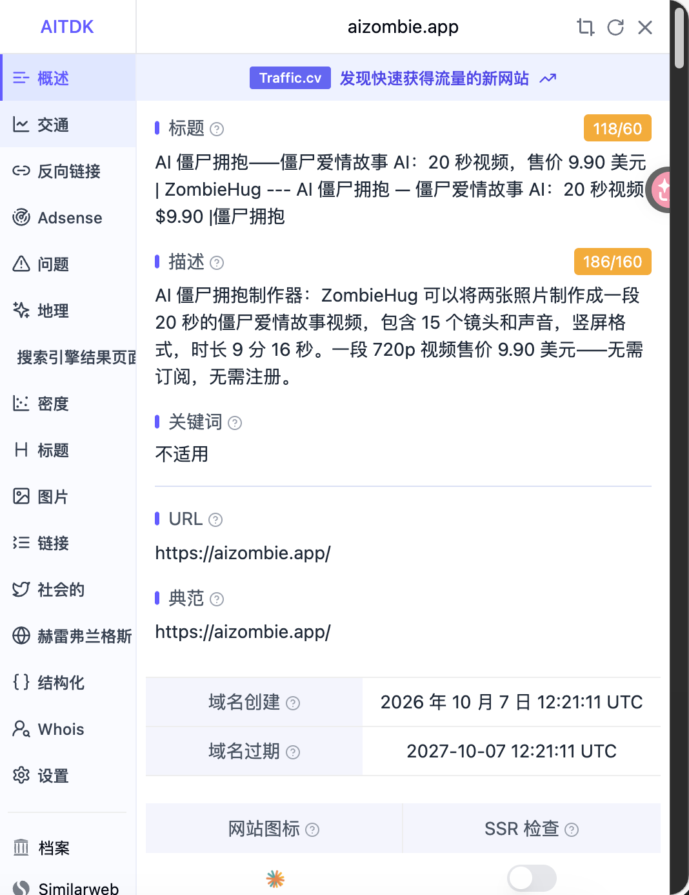
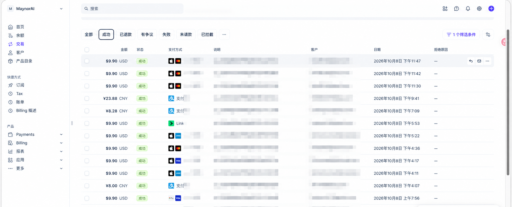

> 在线阅读（GitHub Pages）：https://maynor996.github.io/new-word-site-case/

# 靠一个 zombie 新词站冲日入百刀：从发现到搭建复盘

> 作者：Maynor / Jody Jackson（独立开发）  
> 悬赏周期：2026-09-28～2026-10-08｜新词新站｜文内附截图证明  
> 说明：正文不写站点明文 URL；客户信息已打码。

---

## 1. 介绍你自己和上站经历和以前的战绩

我是 **Maynor / Jody Jackson**，自己搞站的。平时就拿手里那套 **shipany-tanstack**（TanStack Start）+ **Cloudflare Workers / D1** 出活，收款走 **Stripe**，出片走 **Seedance**（经视频 API 聚合）。

国庆这窗口，我其实连打了两站：

1. **InkDoo**（AI 插画积分站）：域名 **2026-10-04** 注册；**2026-10-05 21:57–21:59 CST** 窗口里第一笔成功单就落这儿了——US$4.99，Starter 20 images，微信支付。  
2. **zombie 新词站**（这篇主角）：域名 **2026-10-07** 注册；**2026-10-08** 一堆 **$9.90** 单砸下来，冲「日入百刀」那个量级。本站确认成功单 **一共 10 单**。

*图：InkDoo 域名创建 2026-10-04（悬赏窗口内）。*

*图：Stripe——10 月 5 日 21:57 发起 / 21:59 成功，US$4.99，微信支付；客户和支付 ID 已打码。*

zombie 站长什么样？两张照片丢进去，大概 20 秒，竖屏「僵尸拥抱 / 丧尸拥抱」成片出来。游客能直接付一单（Single 大概 **$9.90**），不用先订订阅。

*图：首页左边样片，右边 Photo 1 / Photo 2，还有 Create · $9.90。*

*图：站内「Made with this effect」分镜示意（自己生成的样片）。*

整条链路就一句话：两图上传 → 固定故事模板拼提示词 → 看积分够不够，不够就跳 Stripe → Worker 调视频 API 开 Seedance 任务 → 轮询出片，失败就把积分退回去。

*图：高层流水线示意。核心就仨字儿：模板、一单买断、API 算力。*

---

## 2. 这次什么时候、因什么契机决定上站

契机不是我对着关键词表算出来的，是 **哥飞社群里刷到 zombie 相关讨论**。

截图是 2026-10-07 的。有人复盘说：要是只盯 KD、CPC，这波单大概率开不出来；他自己更看重**社交媒体热不热**，再对一下 **SERP**，发现几乎没人做，才决定上。我看完就想试——词缝很清楚，缺的是「步骤少、能付一单就走」的壳子，正好叠我现成的 Workers + Stripe + Seedance。

*图：哥飞社群里聊 zombie 关键词和上站判断。*

决定很快：当天查域名、注册完，把模板站改成「僵尸拥抱」产品形态就上了。

---

## 3. 完整经历：域名、上线、流量与首单

### zombie 站域名

- **域名创建（AITDK）**：**2026-10-07 12:21:11 UTC**（上海时间：**2026-10-07 20:21:11 CST**）  
- 落在悬赏窗口 **2026-09-28～2026-10-08** 里。

*图：AITDK「域名创建」字段。正文不另写站点 URL。*

### 时间线（有截图的节点）

| 节点 | 事实 |
|------|------|
| 窗口内第一站域名 | InkDoo · **2026-10-04** |
| 窗口内第一笔订单 | **2026-10-05 21:59 CST** · US$4.99 · InkDoo Starter |
| zombie 站域名 | **2026-10-07 20:21:11 CST** |
| zombie 站出单高峰 | **2026-10-08**：本站确认 **10 单**；Stripe 列表里 $9.90 很密 |

串一下：

- **10-04**：InkDoo 域名落地。  
- **10-05**：窗口第一单落在 InkDoo（$4.99）。  
- **10-07**：哥飞群看到 zombie → 注册域名并上线。  
- **10-08**：zombie 这边冲出「日入百刀」量级（本站 **10 单**）。

视频上游我这边走聚合 API（注册入口：[tryallapi.com](https://tryallapi.com/register?aff=5A6A)），站内调 Seedance；密钥只放 Workers Secret，本文不贴 Key。

---

## 4. 数据回顾

### 订单证明（Stripe，2026-10-08）

下面是 Stripe「交易 → 成功」截图（账号展示名 MaynorAI；说明 / 客户列已打码）。

*图：2026-10-08 Successful 列表（滚动视窗）。*

**本站（新词 + 新站）确认：总共 10 单。**

这张图主要用来证明：出单那天 **$9.90** 很密，支付方式里能看到 Apple Pay、支付宝、Link、卡之类。视窗里同日可能还混着非本站流水，**别拿视窗笔数直接当本站总数**——本站口径就按 **10 单**。

按 Single 大概 $9.90 × 10 粗算，出单日营收落在「日入百刀」那个量级（还没扣 Stripe 手续费和视频上游成本，净利这儿不展开）。

### 付款地区

已知相关地区：**美国、乌克兰、意大利、瑞士**。

---

## 5. 收获

1. **新词不一定要先算 KD。** 哥飞群里那条 zombie 讨论，直接把「有没有同行、社交侧热不热」变成动手信号。  
2. **模板站 + 固定故事模板**，比让用户自己写一长串分镜快多了；$9.90 门槛低，适合热点脉冲。  
3. **Workers + D1 + Stripe + 视频 API → Seedance**，能在很短窗口里从「看到词」走到成片式出单。  
4. **留证习惯**：域名创建截图 + Stripe 成功列表（客户打码），悬赏核对省事。

---

## 6. 感悟

热点新词窗口真的短。这次是 **10-07 看到讨论并注册域名，10-08 就冲出本站 10 单**——再拖一天，SERP 和社交热度可能就不一样了。

技术上更土一点：能收钱的站，关键不是模型名片，而是 **积分先扣、失败退回、Webhook 别串域名、上游撑不住时失败得体面**。对外复盘就写能证明的：域名时间、首单时间、本站单量、地区——截图说多少，就写多少。

---

## 7. 对未参与群友的鼓励

要是你也在哥飞群里刷到新词，还在纠结「KD 好不好看」，不妨先问自己三句：

**社交侧是不是突然在播？SERP 有没有空位？自己有没有现成能收钱的壳？**

两条以上是「是」，就值得像这次 zombie 站一样——先注册、先上最小可付费版，再用截图说话。

国庆这波窗口已经过去了；下一波新词不会等表格算完。一起继续上站。

---

（完）